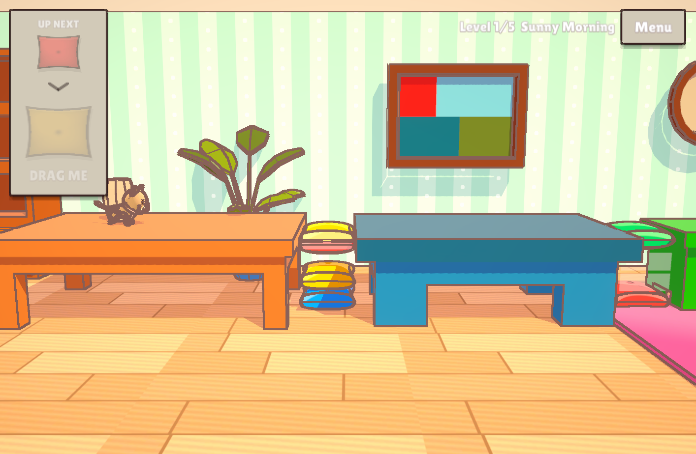
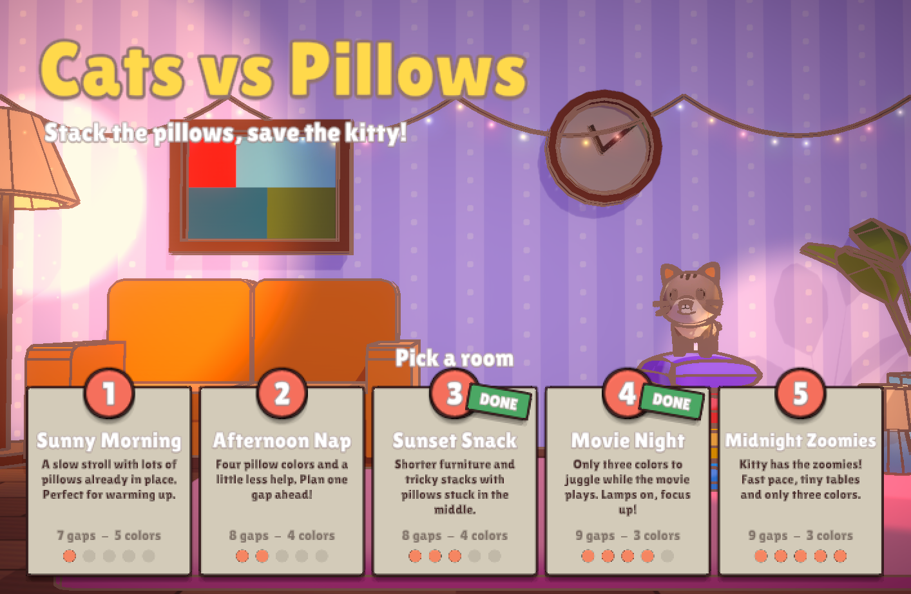
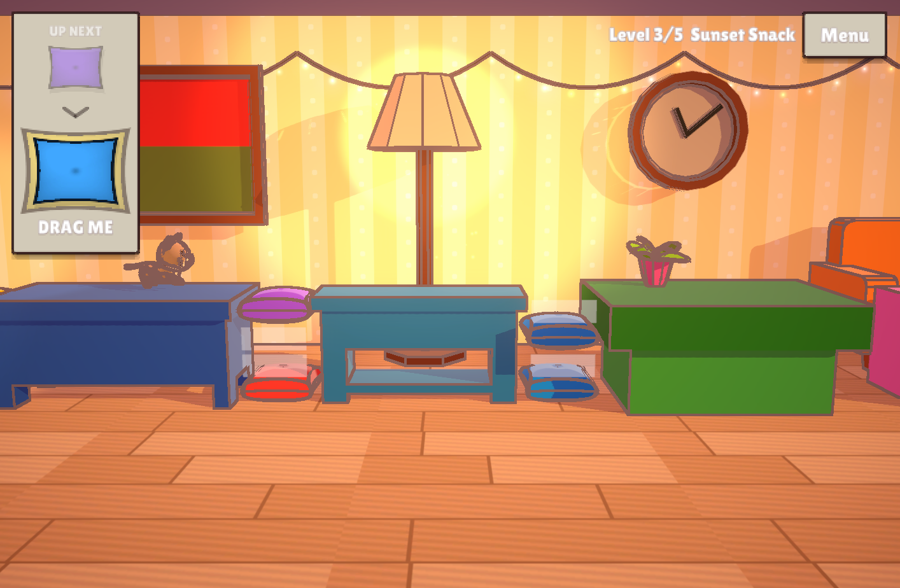
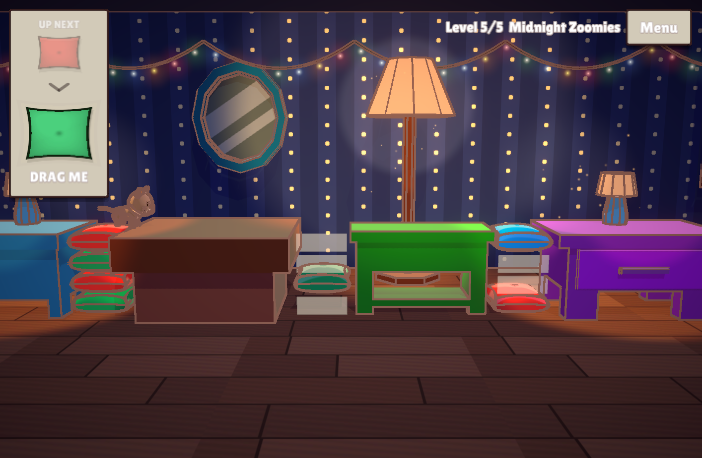

# Cats vs Pillows

A cozy puzzle-platformer for mobile, made in Unity. A cat strolls across the living room, and you have to build pillow bridges over the gaps before it gets there.



## How to play

- The cat walks left to right on its own. Every gap between the furniture must hold a full stack of **4 pillows** before the cat arrives.
- Drag the current pillow from the feed in the top-left into any empty slot. You can always see the pillow that comes next.
- Two pillows of the **same color** must never touch vertically. If they do, both pop.
- If the cat reaches an unfinished gap, it falls and the level restarts.

## Screenshots

| Main menu | Sunset Snack | Midnight Zoomies |
|:---:|:---:|:---:|
|  |  |  |

## Getting started

1. Install **Unity 2022.3.62f3** (any 2022.3 LTS should work). The project uses the Universal Render Pipeline.
2. Clone the repository and open the folder in Unity Hub.
3. Open `Assets/Scenes/MainMenu.unity` and press **Play**.

The game targets landscape mobile devices. In the editor, set the Game view to a 16:9 or wider aspect ratio.

## Making levels

Levels are data-driven, so you can design them without writing code.

| Asset | Purpose |
|---|---|
| `Levels/LevelCatalog` | The play order. The next level in this list starts after a win. |
| `Levels/LevelXX_*` | One level: furniture layout, pre-placed pillows, pillow colors, cat speed, decor and menu text. |
| `Data/Themes/Room_*` | Wallpaper and floor for a room. |
| `Data/Atmospheres/*` | Time of day: sunlight, ambient light, post-processing and lamps. |
| `Data/GameplaySettings` | Global tuning: grid size, timings and prefabs. |

All paths are relative to `Assets/GAME ASSETS/`. Create new assets via **Create → Cats vs Pillows**.

To try out a level, open `Assets/Scenes/Game.unity` and set **Editor Level Index** on the Game Manager. The Scene view previews that level, and pressing Play starts it directly. The **Cats vs Pillows** menu also has a level-progress reset and the generators for the procedural art.

## Project structure

```
Assets/
├── _Scripts/
│   ├── Core/       Game rules (gaps, clashes, pillow queue). Plain C#, no Unity dependency.
│   ├── Runtime/    Gameplay, level building, UI, rendering, data assets
│   ├── Editor/     Scene preview, art generators, menu tools
│   └── Tests/      EditMode tests for the rules and the shipped levels
├── _Shaders/       Toon lighting, screen-space ink outline, additive glow
├── GAME ASSETS/    Levels, themes, materials, prefabs, fonts
└── Scenes/         MainMenu, Game
```

## Tests

Open **Window → General → Test Runner** and run the **EditMode** tests. They cover the stacking and clash rules, the pillow queue, and design checks on every level in the catalog.

## Credits

- Furniture and cat models come from the third-party packs in `Assets/Low Poly Living Room 1` and `Assets/Cartoon Cat`. They belong to their authors and follow their own license terms.
- [Lilita One](https://fonts.google.com/specimen/Lilita+One) font by Juan Montoreano, licensed under the [SIL Open Font License](Assets/GAME%20ASSETS/Fonts/LilitaOne-OFL.txt).
